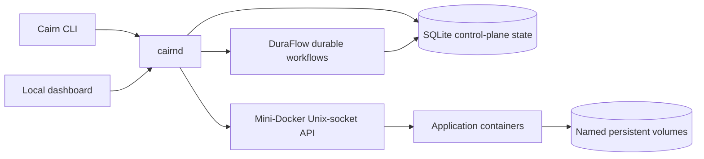
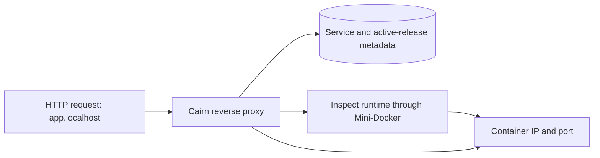
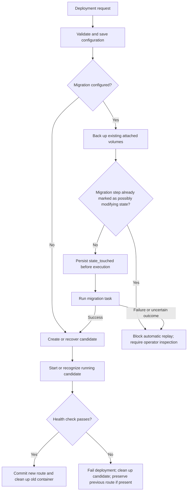

# Cairn

[](https://github.com/Yumekaz/Cairn/actions/workflows/smoke.yml)
[](LICENSE)

**A stateful-first, single-node Linux PaaS for deploying services, preserving data and recovering interrupted deployments.**

Cairn combines a CLI and local dashboard with persistent volumes, backups, HTTP routing, workers and cron jobs. Mini-Docker provides the container runtime; DuraFlow persists deployment, backup and restore workflows. The deployment stack does not require Kubernetes, Docker or containerd.

## What you can do

| Capability | Behavior |
| --- | --- |
| Deploy web services | Start a candidate, check its health, then switch the active route |
| Preserve application data | Mount named host-backed volumes across releases and restarts |
| Back up and restore | Volume archives plus PostgreSQL, Redis and MongoDB recovery drivers |
| Recover controller crashes | Resume durable work while checking actual runtime state |
| Run background work | Long-running workers, one-off commands and cron schedules |
| Inspect operations | Service state, logs, deployment history, backups and audit events |
| Manage configuration | Environment variables and AES-GCM-encrypted secrets using a local key file |

The supported deployment scope is **one Linux host with controlled workloads**. Cairn is not a multi-host scheduler or an independently audited hostile-tenant platform.

## Quick start

Requirements: Linux, Go **1.26.4 or a compatible newer toolchain**, Python **3.10+**, and sudo/root for full Mini-Docker networking and namespace operations. The bootstrap prepares the sibling repositories and runtime prerequisites.

```bash
git clone https://github.com/Yumekaz/Cairn.git
cd Cairn
./scripts/bootstrap_stack.sh --start-runtime
export PATH="$HOME/.local/bin:$PATH"
cairn doctor
./scripts/clean_demo.sh
```

The dashboard is available at **http://127.0.0.1:2476/dashboard/**. Keep it local: Host/origin protections are not authentication or TLS.

Build-only setup is available without privilege:

```bash
./scripts/bootstrap_stack.sh
```

For manual installation, runtime startup and configuration, see [Getting started](docs/GETTING_STARTED.md) and [Quickstart](docs/quickstart.md). Bootstrap starts a local runtime; it is not a claim that permanent boot-enabled services have been installed.

The Go module uses a sibling DuraFlow checkout:

```text
parent/
  Cairn/
  DURAFLOW/
  Mini-Docker/
```

## Architecture

DuraFlow is embedded in Cairn's control plane; Mini-Docker is accessed through its Unix-socket API.



Application requests use the active service's runtime identity and container address:



## Deployment and migration safety

For an existing service, the old route remains active until the candidate passes health checks. A failed candidate is cleaned up; **preserving an old route is not database rollback**.



Failed and interrupted migrations can block rollback to an older release. A forced rollback bypasses that guard; it does not undo migration writes or prove schema compatibility. Inspect the task and data before deciding whether to restore, finish a migration or deploy a compatible application.

See [Migration safety and recovery](docs/MIGRATION_SAFETY.md).

## Service configuration

Cairn uses a local rootfs path, not an automatic container-registry image pull. Set the rootfs location before deploying:

```bash
export CAIRN_ROOTFS="$(pwd)/../Mini-Docker/rootfs"
```

Save this example as `cairn.yaml`. It starts BusyBox HTTP and initializes a small page in a persistent volume:

```yaml
name: web-api
kind: web
image: ${CAIRN_ROOTFS}
command:
  - /bin/sh
  - -c
  - "printf 'Cairn is running\\n' > /www/index.html; exec /bin/busybox httpd -f -p 80 -h /www"
ports:
  - host: 8080
    container: 80
volumes:
  - name: web-data
    mount_path: /www
healthcheck:
  http_path: /index.html
  interval: 2s
  timeout: 1s
  retries: 3
  startup_grace: 1s
restart:
  policy: on-failure
  max_retries: 3
```

```bash
cairn deploy ./cairn.yaml
curl -H 'Host: web-api.localhost' http://127.0.0.1:2476/index.html
```

The page initialization is a demonstration, not an application migration strategy. See the [notes](examples/notes), [worker](examples/worker) and [cron](examples/cron-job) examples for other workload types.

## Everyday commands

```bash
cairn ps
cairn logs web-api
cairn stop web-api
cairn start web-api
cairn restart web-api

cairn env set web-api APP_MODE=development
cairn env list web-api
cairn secret --help

cairn backup create web-data
cairn backup list web-data
cairn restore web-data "<backup-id>"
cairn recovery web-api
```

Replace "<backup-id>" with an ID from the backup list. Environment and secret updates redeploy the service. Secret values are encrypted with a permission-protected local host key; this is **not TPM/HSM-backed encryption**. The current secret CLI accepts values as arguments, so consider shell history and process-argument exposure when using it.

## Verification

The [required CI workflow](.github/workflows/smoke.yml) builds locked stack revisions and runs:

- Core tests, binary builds and clean Linux source installation.
- Shell syntax, verification-runner and dashboard focus regressions.
- Real privileged deployment/recovery and all nine named integration workflows without prerequisite skips.
- Actual PostgreSQL, Redis and MongoDB backup/restore drivers, plus DuraFlow PostgreSQL tests.

The [October validation record](docs/VALIDATION_2026-10.md) separately records live dashboard/data checks, bounded disk-full testing, guest installation/reboot/abrupt shutdown and two independent two-hour soaks. Those sessions do not establish an uninterrupted 24-hour result.

```bash
bash scripts/acceptance_suite.sh
ACCEPTANCE_DATABASES=1 bash scripts/acceptance_suite.sh
./scripts/prove_mlp.sh
```

The six-repository acceptance runner expects sibling checkouts. It retains commands, revisions, patches, exit codes and logs; unavailable prerequisites remain non-green. Live proofs require privileged Mini-Docker. Use dedicated fixtures rather than an existing production deployment.

## Scope and limits

- Migration guards are not an atomic migration protocol or automatic database undo.
- PostgreSQL restores replace objects in the selected dump, not unrelated later-created objects; MongoDB restores are not globally atomic across collections.
- Dashboard Connected means API reachability, not whole-stack health.
- The local admin interface requires a separately secured access layer before public exposure.
- Runtime isolation, exhaustive fault schedules and physical storage/power failures are not universally certified by the retained checks.

## Documentation and related projects

[Architecture](docs/architecture.md) · [Recovery](docs/MIGRATION_SAFETY.md) · [Validation](docs/VALIDATION_2026-10.md) · [Security](SECURITY.md) · [Contributing](CONTRIBUTING.md)

[Mini-Docker](https://github.com/Yumekaz/Mini-Docker) and [DuraFlow](https://github.com/Yumekaz/DURAFLOW) are the deployment dependencies. [FailForge](https://github.com/Yumekaz/FAILFORGE), [MiniDB](https://github.com/Yumekaz/Mini-Redis-Cassandra) and [Coordination-service](https://github.com/Yumekaz/Coordination-service) are connected verification/reference projects, not Cairn's production metadata store.

## License

[MIT](LICENSE).
